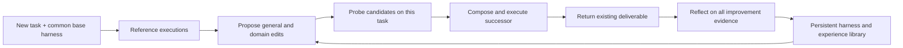

# Harness² reading guide

**How an agent can improve the harness for today's task and retain experience for tomorrow's edits.**

An independent reading companion to **Harness²: Recursive Agent Harnessing for an Open World**, by **Ruiyao Xu, Yanfei Chen, Zhongying CuiZhu, Bhavana Dalvi Mishra, Yifei Ming, Han Yu, Rujun Han, Chen-Yu Lee, and Tomas Pfister**.

[Paper v1](https://arxiv.org/abs/2610.14224v1) · [PDF v1](https://arxiv.org/pdf/2610.14224v1) · [Authors' implementation](https://github.com/google-research/harness2) · [Authors' project](https://harness2.github.io/) · [Sources](SOURCES.md)

> This repository explains the paper; it is not the authors' implementation, an official Google project, or an experimental reproduction. It covers all **37 pages of arXiv:2610.14224v1**, including appendices A–H, figures, tables, and stage prompts. All research scores below are reported by the authors. No model or benchmark runs were performed here.

## The idea in a minute

The model stays frozen. The system changes the files around it: instructions, skills, scripts, delegation, and tool-loop hooks. For each task, it proposes both a general workflow repair and a domain-specific repair, executes the candidate harnesses, and composes a successor using the observed behavioral differences. These contrasts are useful evidence; they are not correctness labels.

After the task, the system saves the adopted harness and supported lessons about the improvement process in a library. **The next task starts from the common base harness, not the previous task's final harness.** The library guides new proposals and composition. That second feedback loop is the paper's harnessing-level recursion. See [concepts](docs/01-concepts.md) and [the method](docs/02-method.md).



*Original simplified diagram. Within a task the improvement library is fixed; its update happens afterward. For budget k > 1, a separate blind selector chooses an existing output. [§2, pp. 4–7](https://arxiv.org/pdf/2610.14224v1#page=4).*

## Choose a reading route

| Your goal | Start here | Then read |
| --- | --- | --- |
| Understand the contribution | [1. Concepts](docs/01-concepts.md) | [2. Method and evidence flow](docs/02-method.md) |
| Assess the empirical case | [3. Results and protocols](docs/03-results.md) | [4. Critical reading](docs/04-critical-reading.md) |
| Read alongside the PDF | [5. Complete paper map](docs/05-paper-map.md) | Figures, tables, equations, and prompts at their source pages |
| Plan your own investigation | [6. Discussion and reproduction planning](docs/06-discussion-and-reproduction.md) | [Source and release differences](SOURCES.md#paper-and-release-differences) |
| Use an agent with this guide | [AGENTS.md](AGENTS.md) | [llms.txt](llms.txt), [claim index](metadata/claims.json), [reported data](data/reported-results.json) |

## What the results support

| Finding | Exact scope | Qualification |
| --- | --- | --- |
| One contrastive step improves the base in all 12 benchmark/configuration pairs | Two executors × two initial harnesses × three benchmark metrics, Tables 1–2 | This is not a win against every baseline or in every WorkBuddy domain. |
| Largest one-step gains: **+11.5 WorkBuddy points**, **+4.5 JobBench points**, **+11.8 LAB percentage points** | Respectively GLM-5/OpenCode, Gemini 3.5 Flash/OpenCode, GLM-5/OpenCode | WorkBuddy uses a three-domain macro-average; LAB Partial is a criterion pass rate. These are absolute differences. |
| Parallel recursion at k = 5 adds **2.9–3.9 WorkBuddy points**, **3.0–4.2 JobBench points**, **2.6–6.7 LAB percentage points** | Over k = 1 in main Tables 1–2 | Additional executions and improvement sessions cost compute. The table gives mean deltas, not k = 5 standard deviations. |
| Removing the library, scoped editors, or composition lowers scores | Gemini 3.5 Flash/OpenCode, k = 1, WorkBuddy and JobBench, Table 3 | A targeted ablation, not a universal causal decomposition. |

Sources: [Table 1, p. 8](https://arxiv.org/pdf/2610.14224v1#page=8), [Table 2, p. 9](https://arxiv.org/pdf/2610.14224v1#page=9), [Table 3, p. 10](https://arxiv.org/pdf/2610.14224v1#page=10). [Results chapter](docs/03-results.md) includes baselines, uncertainty, transfer studies, and structured transcriptions.

## Four distinctions to keep

- **Editing evidence and evaluation:** the pipeline uses trajectories and artifacts, while benchmark rubrics and scores are reserved for evaluation in the paper's protocol.
- **Task recursion and continual state:** parallel k controls one population update's width; sequential k controls chained refinement. Across tasks, only the improvement library evolves; model weights, stage instructions, and decision rule remain fixed.
- **Selection and verification:** a selected deliverable is adopted, not proven optimal or correct. The failure analysis includes a selector choosing an output scoring 55 when a candidate scoring 95 was available.
- **Execution length and total compute:** `#Steps` counts model turns in an executor session. Figure 6 separately includes execution and improvement token costs before submission.

See [method](docs/02-method.md), [critical reading](docs/04-critical-reading.md), and [Appendix E.6, p. 26](https://arxiv.org/pdf/2610.14224v1#page=26).

## Provenance and reuse

The supported attachment download failed at a Windows metadata operation. This guide uses the matching official arXiv v1 PDF: 37 pages, 8,101,889 bytes, SHA-256 `440be1f694f3b0fdfb8e612e9b2288ff0d8ab38641cfd1064fd77052ba360282`. **Byte equivalence with the attachment has not been verified.** The arXiv history lists v1 as submitted October 9, 2026; the PDF's header says October 12. The history showed only v1 when checked October 16. [Full provenance](SOURCES.md).

The paper is listed as CC BY 4.0 and the authors' code as Apache-2.0. This repository publishes original explanations and attributed structured summaries, without the PDF or paper figures. Original guide material is [CC BY 4.0](LICENSE.md); the checker is [MIT](scripts/LICENSE). [Attribution](ATTRIBUTION.md) separates those scopes.

## Check or contribute

```bash
python scripts/check_docs.py
```

The dependency-free checker verifies publication scope, links and anchors, metadata, source-page bounds, and selected numerical consistency. It does not reproduce or validate the research. See [verification](VERIFICATION.md) and [contribution guidance](CONTRIBUTING.md).

For scholarship, cite the paper using [BibTeX](references.bib) or the preferred citation in [CITATION.cff](CITATION.cff). Related independent guides: [Harness Learning](https://github.com/0xHayd3n/harness-learning-guide) and [Wait or Probe](https://github.com/0xHayd3n/wait-or-probe-guide).
